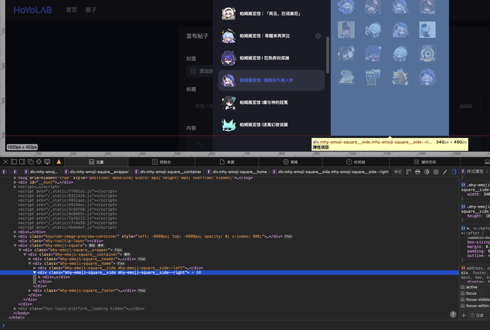

# HoYoLab 表情包收集
爬取和整理HoYoLab（米游社）上的表情包。（会尽快更新的）

<p align="center">
  <a href="https://github.com/iBobbyTS/HoYoLabStickerDownload/releases/latest">已发布的打包下载</a>
</p>

<p align="center">
  
  
</p>

<p align="center">
  
  
  
</p>

## 目录
- [介绍](#介绍)
- [最新更新与下载](#最新更新与下载)
- [脚本使用](#脚本使用)
- [Agent 流程](AGENTS.md)
- [贡献](#贡献)
- [未命名文件](#未命名文件)

## 介绍
这里收集了 HoYoLab 上的表情包，HoYoLab 是国际版米游社，表情包从聊天界面抓取，HoYoLab 上表情包分辨率比米游社高。

原神的表情包只有`派蒙的画作（官方）`是官方的，其他是平台收录的同人表情包；星穹铁道和绝区零的都是官方的。原则上这些表情包仅限 HoYoLab 中使用，本仓库收录的表情包建议个人使用比如[生成贴纸](https://github.com/iBobbyTS/RandomLayoutSticker)，其他用途请遵守 HoYoLab 的相关规定。

目前包含以下游戏：
- 原神
- 崩坏：星穹铁道
- 绝区零

具体收录以 `HoYoLab表情包/` 下的文件为准，最新补充见下文；不以最高版本号表示中间各版本均已收齐。

未包含游戏（欢迎玩家pull request到本仓库）：
- 崩坏学园2
- 崩坏3
- 未定事件簿

## 最新更新与下载
2026-10-22 已通过 [PR #8](https://github.com/iBobbyTS/HoYoLabStickerDownload/pull/8) 合入 **136 张官方原图**，保留原始格式、画质和动画：

- 原神：派蒙的画作第 53 弹（7.1「往冥府的安魂歌」），16 张。
- 崩坏：星穹铁道：4.0、4.2、4.4、4.6 帕姆展览馆各 16 张，另有「帕姆驾到 日常篇」16 张 GIF，共 80 张。
- 绝区零：「丽都漫步 7」32 张、「甜蜜暴击」8 张，共 40 张。未确认的游戏版本不作推断。

本批 77 张待命名图片已完成命名，另修正 21 张角色或形态名称，并同步更新 `character.json`。例如不死途、千冶·刃、银狼LV.999、知更鸟·晴歌、砂金·戏浪、姬子·启行及琉音；汪汪丹保留与丹恒的关联命名。

**本次只更新仓库，未发布新的 Release。** 获取这些新增图片，请浏览 [原图目录](HoYoLab表情包/)，或在仓库首页选择 **Code → Download ZIP** 下载当前 `main`，再按下文自行打包。[已发布的 Release](https://github.com/iBobbyTS/HoYoLabStickerDownload/releases/latest) 与当前仓库可能不同步，不包含本次新增内容。

## 脚本使用
使用 Python 3，在仓库根目录运行。只整理、打包现有图片时，不需要先运行抓取脚本，也不需要安装第三方依赖。

### `scrap.py`
这是手动粘贴 HTML 的备用下载入口，并非自动增量更新工具。使用前安装依赖：

```sh
python -m pip install requests lxml
```

在 HoYoLab 的[发帖页面](https://www.hoyolab.com/newArticle/1)打开表情包列表，通过检查元素复制表情包的完整 div。

将其粘贴到 `scrap.py` 顶部的 `html` 变量，再运行 `python scrap.py`，图片会下载到 `Download/<表情包名称>/`。

随后核对原图、角色和目录命名，再移动到 `HoYoLab表情包/` 对应目录。旧脚本会直接丢弃 URL 查询参数，不能据此保证取得正确原图；官方 API、原图参数处理、去重及验证规范见 [Agent 流程](AGENTS.md)。版本无法确认时保留包名或稳定序号，不猜测版本。

### `sort.py`
按 `character.json` 将图片副本分类到 `release/<游戏>/<分组>/<角色>/`，并生成 `release/未使用表情包.log`。角色名称优先完整字段匹配，避免把衍生形态归入基础角色；未命中完整字段时保留旧文件名的兼容匹配。

新增角色或确认名称后，应同时维护 `character.json`，保留已有伴生角色关联规则。仅需要分类或调试时运行 `python sort.py`。

### `release.py`
运行一次即可完成分类和 ZIP 打包，无需先单独执行 `sort.py`：

```sh
python release.py
```

输出 `release/原神.zip`、`release/崩坏：星穹铁道.zip`、`release/绝区零.zip`，不会自动创建 GitHub Release。

如果 `release/` 已存在，脚本会询问是否删除重建。请先备份需要保留的输出，不要直接确认删除。

2026-10-22 打包验证：原神 1016 张、星穹铁道 498 张、绝区零 200 张，本次新增 136 张全部收录；另有 **53 张历史素材未匹配**，仍保留在原图目录，需查看本地生成的 `release/未使用表情包.log`。这不代表全部历史素材已完成分类。

修改角色匹配逻辑后，可运行回归测试：

```sh
python -m unittest test_sort.py
```

## 贡献
欢迎给更新的表情包和尚未纳入的游戏提交 pull request。注意使用`scrap`脚本爬取后，自己将文件夹和表情包重命名，文件夹命名保留原本的序号，确认后再添加游戏的版本号和版本名（如`派蒙的画作第41弹` `->` `派蒙的画作（官方）/41-5.6 悖理`）。

表情包命名示例
- `角色名 - 当前文件夹里的序号`，如`妮露 - 1.png`
- 月桂是瑶瑶的，使用者如果想找瑶瑶的表情包，可能也需要月桂的，所以把单独月桂的表情包命名为`月桂 - （瑶瑶） - 1.png`，瑶瑶+月桂的表情包命名为`瑶瑶.png`即可（另还有锅巴、萨姆等）
- 包含多个角色的全都写上，如`妮可 - 安比.png`

## 未命名文件
以下为历史待命名文件，不包括本次已完成命名的 77 张；待命名与打包未匹配是不同状态。有些角色不认识，还有些东西比较抽象，欢迎帮忙命名。
```
绝区零/2024.6.25 Drip Fest/aec3d3a141014f694f528e71b1e092c6_5474911687596017974.png
绝区零/2024.6.25 Drip Fest/af92fe4fe5cc86e60e630dcba9c5cfd7_2069708535072993456.png
绝区零/2024.6.25 Drip Fest/fd64367bdb24b37f574d19915f050aba_1815080081349496467.png
绝区零/2024.6.25 Drip Fest/4291a31e632524721a82027e249900a6_3150220501018219332.png
绝区零/2024.6.25 Drip Fest/1961f3a797ed5d902cbfa3a0e39c2eb6_6694731625436582903.png
绝区零/2024.6.25 Drip Fest/88676963e045b214737d861d1c78e676_1674452690828452196.png
2022愚人节系列表情包/e58ce0b3f8663e1bcd6b9ee3c9aa2c56_2017792494863154359.gif
2022愚人节系列表情包/b9385a53b593c04d53caed4ba71cdf55_8705970719420136701.gif
2022愚人节系列表情包/0ac5dff15c0ac8b6d0d4d8c6c310ecc1_7011582623642354130.gif
崩坏：星穹铁道/帕姆展览馆（按版本）/2.2 等醒来再哭泣/a3d8d1b37472090172c1b682f50e4ed6_6744105025861654824.png
崩坏：星穹铁道/帕姆展览馆（按版本）/2.4 明霄竞武试锋芒/fe8d6dec192622beff242da6dd1154fa_9021052065824720626.png
原神/HoYoLab 非官方/「提瓦特新闻」系列表情包/4cb8def8a608083044c3b9e76f8e6289_3797313058364198657.png
原神/HoYoLab 非官方/「提瓦特新闻」系列表情包/81e96a4c2d7c6f9d8abe0d8cfd38d484_1570056176368386502.png
原神/派蒙的画作（官方）/19-3.2 虚空鼓动，劫火高扬/6f0ac2f49034b2e921cdc9c6c77f7a85_6516064932807854321.png
```
